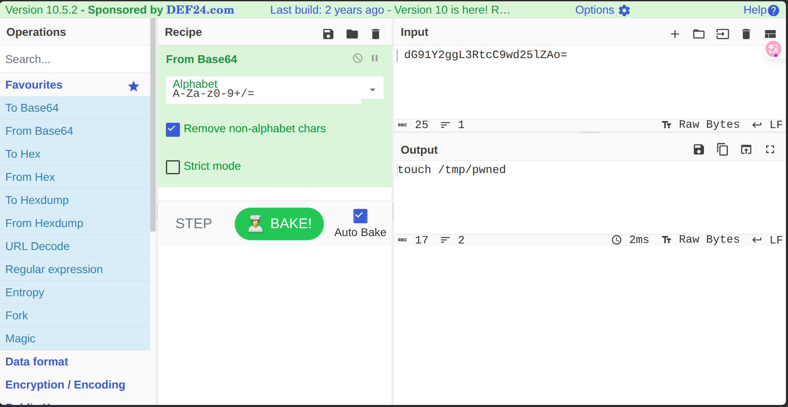

# **Task 1: Introduction**

*The room invites you a challenge to investigate a series of traffic data and stop malicious activity under different scenarios. Let’s start working with Zeek to analyze the captured traffic.*

*We recommend completing the [**Zeek](https://tryhackme.com/room/zeekbro)** room first, which will teach you how to use the tool in depth.*

Note: Also see my walkthrough of the Zeek room: [TryHackMe: Zeek (SOC Level 1)](https://www.jalblas.com/blog/tryhackme-zeek-soc-level-1/)

# **Questions**

# **Read the task above.**

> Answer: No answer needed
> 

---

# **Task 2: Anomalous DNS**

*An alert triggered: “Anomalous DNS Activity”.*

*The case was assigned to you. Inspect the PCAP and retrieve the artefacts to confirm this alert is a true positive.*

# **Questions**

# **Q1: Investigate the dns-tunneling.pcap file. Investigate the dns.log file. What is the number of DNS records linked to the IPv6 address?**

Alright, are you ready? It’s time to investigate the dns-tunneling.pcap file, which can be found in the /Desktop/Exercise-Files/anomalous-dns folder.

We can read the pcap file with this simple command:

```
zeek -C -r dns-tunneling.pcap
```

This simple reads the pcap file (-r flag), while ignoring checksums (-C flag). You will see the expected log files being created:


Reading the dns-tunneling.pcap file

Now, time to read the dns.log file. The dns.log file generated by Zeek contains detailed information about DNS queries and responses. Each row represents a DNS event, and the columns provide various details about the query, response, and metadata.

We can read this file in a bunch of ways, depending on your CLI ninja skills. Here is one using zeek-cut, which we learned about in the previous room:

```
cat dns.log | zeek-cut qtype qtype_name | grep "AAAA" | wc -l
```

This counts all rows in which the qtype_name is equal to ‘AAAA’.

Alternatively, you could be even more awesome by using a command utilizing awk:

```
cat dns.log | awk '$14 == "AAAA" {print $0}' | wc -l
```

This basicly does the same, but checks the 14th column for the value of ‘AAAA’.


The number of DNS records linked to the IPv6 address

With both methods we get the answer 320.

> Answer: 320
> 

# **Q2: Investigate the conn.log file. What is the longest connection duration?**

Now it is time to look at the conn.log file. This time we should be able to zeek-cut on the duration, and sort the values!

```
cat conn.log | zeek-cut duration | sort
```


Longest duration

You will see the highest duration in the bottom.

> Answer: 9.420791
> 

# **Q3: Investigate the dns.log file. Filter all unique DNS queries. What is the number of unique domain queries?**

I st[https://www.jalblas.com/wp-content/uploads/2025/02/Zeek-Exercises-Banner.png.webp](https://www.jalblas.com/wp-content/uploads/2025/02/Zeek-Exercises-Banner.png.webp)arted with the following command:

```
cat dns.log | zeek-cut query
```

The problem here is that there a tons of unique queries ending with .cisco-update.com.


Lots of cisco-update queries

This could indicate DNS Tunneling. Anyway, we need to filter these out somehow. The hint mentions that we can use the following CLI magic to filter out the first two parts of the domain (done by first reversing, and then removing the first 2 parts):

```
cat dns.log | zeek-cut query |rev | cut -d '.' -f 1-2 | rev | head
```

We can expand on this by adding a reverse and finding all unique values:

```
cat dns.log | zeek-cut query |rev | cut -d '.' -f 1-2 | rev | sort | uniq
```


Unique DNS queries

There we have the answer: 6.

> Answer: 6
> 

# **Q4: There are a massive amount of DNS queries sent to the same domain. This is abnormal. Let’s find out which hosts are involved in this activity. Investigate the conn.log file. What is the IP address of the source host?**

This one is relatively simple. Just zeek-cut on the orig_h column (host IP), sort and count the occurrences of each unique source IP addres.

```
cat dns.log | zeek-cut id.orig_h | sort | uniq -c
```


IP Address of source host

> Answer: 10.20.57.3
> 

---

# **Task 3: Phishing**

*An alert triggered: “Phishing Attempt”.*

*The case was assigned to you. Inspect the PCAP and retrieve the artefacts to confirm this alert is a true positive.*

# **Questions**

Before move on, make sure you are in the right directory:

```
/home/ubuntu/Desktop/Exercise-Files/phishing
```

# **Q1: Investigate the logs. What is the suspicious source address? Enter your answer in defanged format.**

Let’s read the pcap file:

```
zeek -C -r phishing.pcap
```

This creates the different log files we will be looking at. To answer the question we should look at the conn.log by using `cat conn.log`.


Connection log entries

As you will see, all traffic originates from the same source IP, so this is the question.

You can defang the IP address here with the use of CyberChef: [https://gchq.github.io/CyberChef/#recipe=Defang_IP_Addresses()&input=MTAuNi4yNy4xMDI](https://gchq.github.io/CyberChef/#recipe=Defang_IP_Addresses()&input=MTAuNi4yNy4xMDI).

> Answer:10[.]6[.]27[.]102
> 

# **Q2: Investigate the http.log file. Which domain address were the malicious files downloaded from? Enter your answer in defanged format.**

Now read the http.log file: `cat http.log`.


HTTP log file

On the second and third row you will see the URL. It is easier to see with the following use of zeek-cut:

```
cat http.log | zeek-cut host
```


Different domain addresses

Defang the URL by using CyberChef again:

[https://gchq.github.io/CyberChef/#recipe=Defang_URL(true,true,true,’Valid%20domains%20and%20full%20URLs’)&input=c21hcnQtZmF4LmNvbQ](https://gchq.github.io/CyberChef/#recipe=Defang_URL(true,true,true,'Valid%20domains%20and%20full%20URLs')&input=c21hcnQtZmF4LmNvbQ)

The answer is smart-fax[.]com.

> Answer: smart-fax[.]com
> 

# **Q3: Investigate the malicious document in VirusTotal. What kind of file is associated with the malicious document?**

Note that in the http.log, the document (Invoice&MSO-Request.doc) has the uid of CHmDLC4o4IdybQQyN9.

Now we can look at the files.log file.


files.log file

Unfortunately the row corresponding to the msword file has empty values for the hash types. So we can either resort to some quick searching online, which lead me here:

[https://any.run/report/f808229aa516ba134889f81cd699b8d246d46d796b55e13bee87435889a054fb/4980e84e-bfef-4b4a-86aa-6d3d1d2cd84b](https://any.run/report/f808229aa516ba134889f81cd699b8d246d46d796b55e13bee87435889a054fb/4980e84e-bfef-4b4a-86aa-6d3d1d2cd84b)

Which led me here with the hash found on the any.run page:

[https://www.virustotal.com/gui/file/f808229aa516ba134889f81cd699b8d246d46d796b55e13bee87435889a054fb](https://www.virustotal.com/gui/file/f808229aa516ba134889f81cd699b8d246d46d796b55e13bee87435889a054fb)

Or we can use the hash-demo.zeek script we learned about in the previous room:

```
zeek -C -r phishing.pcap hash-demo.zeek
```

Now try reading the files.log again:

```
cat files.log | zeek-cut fuid md5 mime_type
```


md5 hashes visible

The md5 hash is *b5243ec1df7d1d5304189e7db2744128*.

Search on VirusTotal and you will find the following page:

[https://www.virustotal.com/gui/file/f808229aa516ba134889f81cd699b8d246d46d796b55e13bee87435889a054fb](https://www.virustotal.com/gui/file/f808229aa516ba134889f81cd699b8d246d46d796b55e13bee87435889a054fb)

Now have a look at the Relations tab on the page.


Malicious document associated file type (VBA)

In the bottom you will see that the associated file type is VBA. This is Visual Basic code, often used for Macros.

> Answer: VBA
> 

# **Q4: Investigate the extracted malicious .exe file. What is the given file name in Virustotal?**

We have earlier also found the md5 of the exe file. See the screenshot above. The hash is: *cc28e40b46237ab6d5282199ef78c464*.

Searching on this hash on VirusTotal will bring you to the following page:

[https://www.virustotal.com/gui/file/749e161661290e8a2d190b1a66469744127bc25bf46e5d0c6f2e835f4b92db18](https://www.virustotal.com/gui/file/749e161661290e8a2d190b1a66469744127bc25bf46e5d0c6f2e835f4b92db18)


PleaseWaitWindows

Here you can find the answer highlighted.

> Answer: PleaseWaitWindow.exe
> 

# **Q5: Investigate the malicious .exe file in VirusTotal. What is the contacted domain name? Enter your answer in defanged format.**

Let’s look more at the VirusTotal page.

The answer can be found multiple places. One is under *Contacted Domains* in the *Relations* tab.


Contacted domains

But you can also find the info on the *Behavior* tab, underneath *DNS Resolutions*.


DNS Resolutions section

The correct answer is the hopto one, and we can defang this URL at CyberChef: [https://gchq.github.io/CyberChef/#recipe=Defang_URL(true,true,true,’Valid%20domains%20and%20full%20URLs’)&input=ZHVubG9wLmhvcHRvLm9yZw](https://gchq.github.io/CyberChef/#recipe=Defang_URL(true,true,true,'Valid%20domains%20and%20full%20URLs')&input=ZHVubG9wLmhvcHRvLm9yZw)

> Answer: hopto[.]org
> 

# **Q6: Investigate the http.log file. What is the request name of the downloaded malicious .exe file?**

We can find this answer in the http.log file we looked at earlier:


Request name of exe file

The answer is in the *uri* column of the third row (the one related to the malicious .exe file).

> Answer: knr.exe
> 

---

# **Task 4: Log4J**

***An alert triggered:** “Log4J Exploitation Attempt”.*

*The case was assigned to you. Inspect the PCAP and retrieve the artefacts to confirm this alert is a true positive.*

Before we move on, you might be wondering what Log4J is?

Apache Log4j is a Java-based logging utility originally written by Ceki Gülcü. Log4j is used by developers to keep track of what happens in their software applications or online services. It’s basically a huge journal of the activity of a system or application. This activity is called ‘logging’ and it’s used by developers to keep an eye out for problems for users.

Log4shell is a critical vulnerability in Log4j, which is used by millions of computers worldwide running online services. This task might be related to that?

# **Questions**

# **Q1: Investigate the log4shell.pcapng file with detection-log4j.zeek script. Investigate the signatures.log file. What is the number of signature hits?**

Make sure you move into the log4j directory at /home/ubuntu/Desktop/Exercise-Files/log4j.

To investigate the log4shell.pcp with the detection-log4j.zeek script run the following command:

`zeek -C -r log4shell.pcapng detection-log4j.zeek`

A bunch of log files is again created.

In case you are wondering. The zeek script we used is very simple:

`# Load scan-NG Package!@load /opt/zeek/share/zeek/site/cve-2021-44228`

It simply loads the scan-NG package.

Now let’s have a look at the signatures.log file:


Number of signature hits

You can see three entries in the file. You can also run a command such as:

`cat signatures.log | zeek-cut uid | wc -l`

This also returns 3.

> Answer: 3
> 

# **Q2: Investigate the http.log file. Which tool is used for scanning?**

Simply cat the http.log file:


HTTP log entries

Nmap is mentioned on every line in the user_agent field! NMap is used to scan the 172.17.0.2 host on different ports.

You can also run `cat http.log | zeek-cut user_agent`.

> Answer: Nmap
> 

# **Q3: Investigate the http.log file. What is the extension of the exploit file?**

Take a better look around. This time I opened the file in Pluma:


Exploit file found

You should be able to see some log entries that mention a exploit with the .class extension.

For a better look you can run:

`cat http.log | zeek-cut host uri | grep .class`


Finding all exploit calls

> Answer: .class
> 

# **Q4: Investigate the log4j.log file. Decode the base64 commands. What is the name of the created file?**

Read the first lines of the log4j.log file:

`cat log4j.log | head`

You should see two entries including base64 commands:


Base64 commands

The first one includes the base64 command: `*dG91Y2ggL3RtcC9wd25lZAo=`* and the other `*2hpY2ggbmMgPiAvdG1wL3B3bmVkCg==`.*

Now you can take this commands to cyberchef:

 



> Answer: pwned
> 

---

# **Task 5: Conclusion**

*Congratulations! You just finished the Zeek room. In this room, we covered Zeek, what it is, how it operates, and how to use it to investigate threats. Now, we invite you to complete the Zeek Exercise room: [**ZeekExercises**](https://tryhackme.com/room/zeekbroexercises)*

# **Questions**

# **Read the task above.**

> Answer: No answer needed.
> 

---

# **Congratulations on completing Zeek Exercises!!!**


Congratulations on completing Zeek Exercises
