hi everyone, anther write-up for lab about my fav platform CyberDefenders

[Blue team CTF Challenges | insider — CyberDefenders](https://cyberdefenders.org/blueteam-ctf-challenges/insider/)

Category : Endpoint Forensics


### Scenario :

After Karen started working for ‘TAAUSAI,’ she began doing illegal activities inside the company. ‘TAAUSAI’ hired you as a soc analyst to kick off an investigation on this case.

You acquired a disk image and found that Karen uses Linux OS on her machine. Analyze the disk image of Karen’s computer and answer the provided questions.

### **Q1: Which Linux distribution is being used on this machine?**

First of all, we will download FTK Imager from: [https://www.exterro.com/ftk-product-downloads/ftk-imager-4-7-3-81](https://www.exterro.com/ftk-product-downloads/ftk-imager-4-7-3-81) and import image file

go to **root → boot**

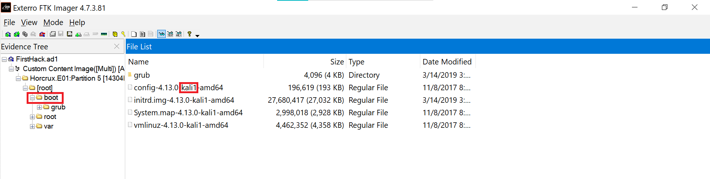

```
kali
```

---

### **Q2: What is the MD5 hash of the Apache access.log file?**

go to root —> var —>log —> apache2

i found **access.log** file 

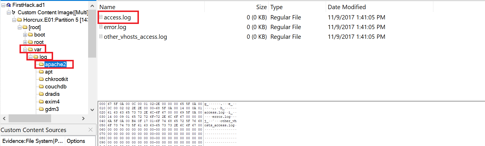

then, i export it and calculate his **MD5 hash by PowerShell .**

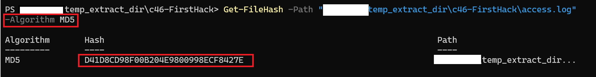

```jsx
d41d8cd98f00b204e9800998ecf8427e
```

---

### **Q3: It is suspected that a credential dumping tool was downloaded. What is the name of the downloaded file?**

> go to root →  root → Downloads→ apache2
> 

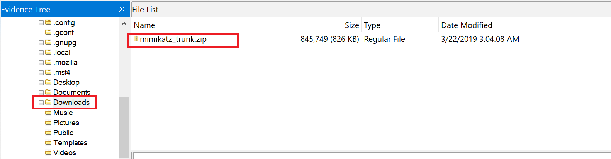

```jsx
mimikatz_trunk.zip
```

---

### **Q4: A super-secret file was created. What is the absolute path to this file?**

> go to root →  root → .bash_history
> 

i found command that :

“touch snky snky > /root/Desktop/**SuperSecretFile.txt** ”

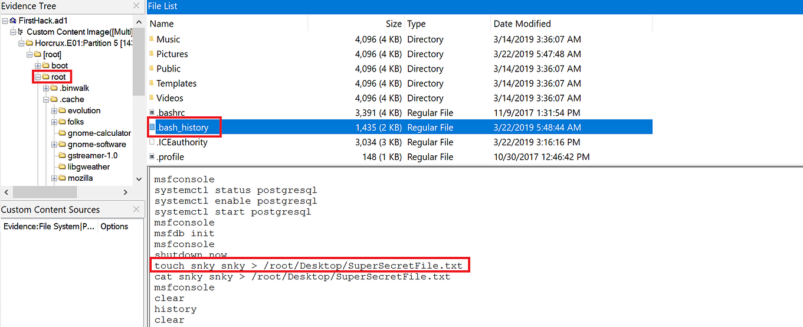

```jsx
/root/Desktop/SuperSecretFile.txt
```

---

### **Q5: What program used the file didyouthinkwedmakeiteasy.jpg during its execution?**

> go to root → root → .bash_history
> 

i found this program “ binwalk ”

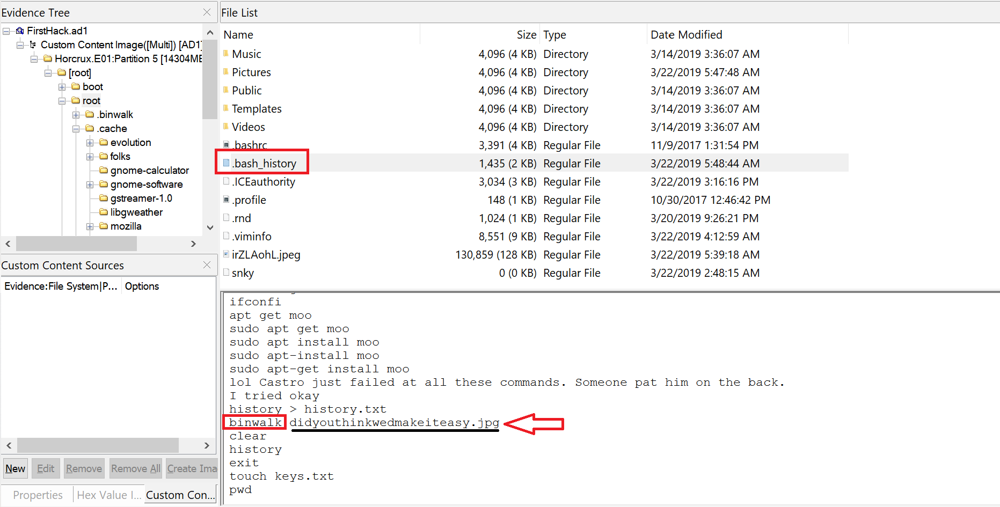

```jsx
binwalk
```

---

### **Q6: What is the third goal from the checklist Karen created?**

go to **/root/Desktop/documents/checklist**

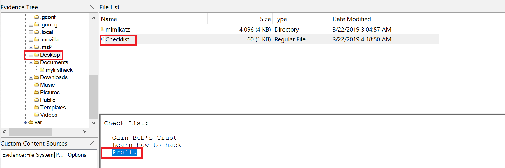

```jsx
profit
```

---

### **Q7: How many times was Apache run?**

> go to root → var → log → apache2
> 


now I don’t see any attempt to implement it.

```jsx
0
```

---

### **Q8:This machine was used to launch an attack on another. Which file contains the evidence for this?**

> go to root → root → irZLAohL.jpeg
> 

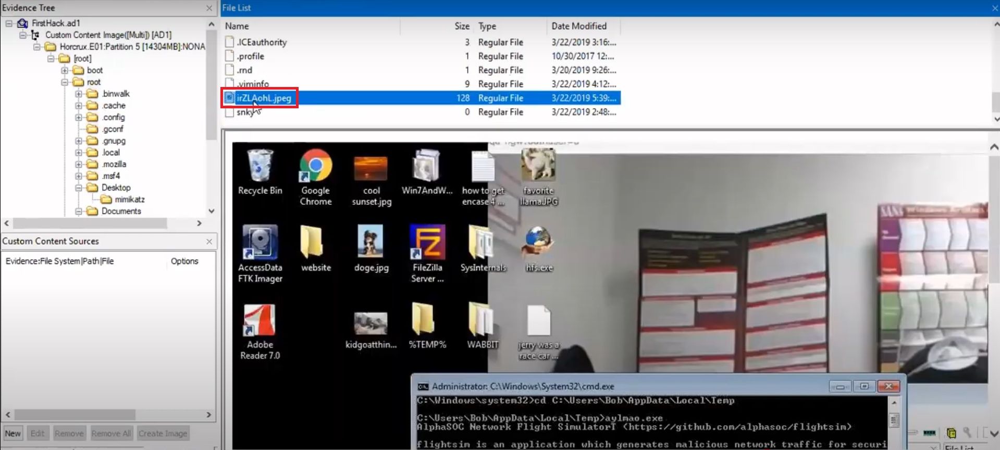

```jsx
irZLAohL.jpeg
```

---

### **Q9:It is believed that Karen was taunting a fellow computer expert through a bash script within the Documents directory. Who was the expert that Karen was taunting?**

> go to root → root → documents → myfristhack —> fristscript_fixed
> 

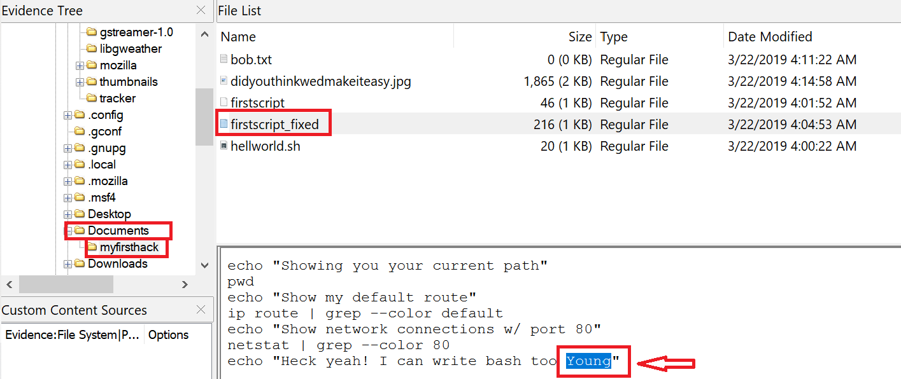

```jsx
Young
```

---

### **Q10:A user executed the su command to gain root access multiple times at 11:26. Who was the user?**

> go to root → var → log → auth.log
> 

postgres execute the su command to gain root access multiple times

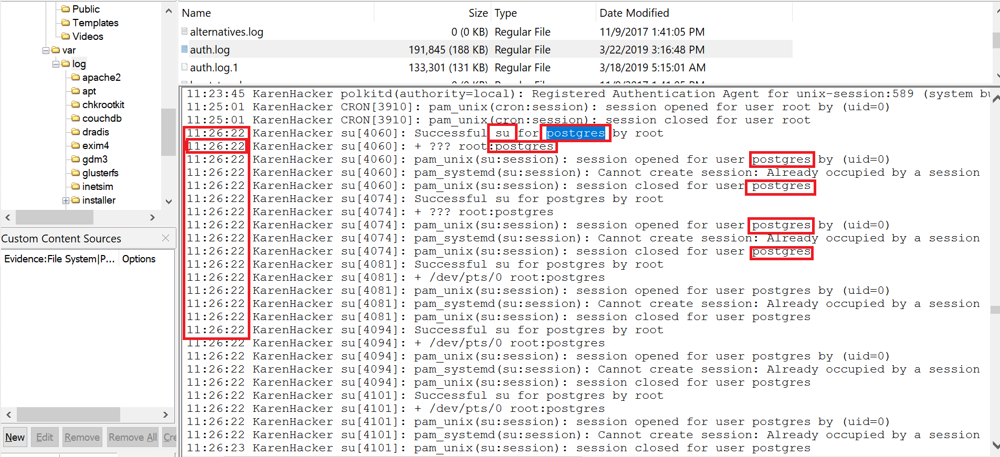

```jsx
postgres
```

---

### **Q11:Based on the bash history, what is the current working directory?**

Based on the bash history,

> go to root → root →.bash_history
> 

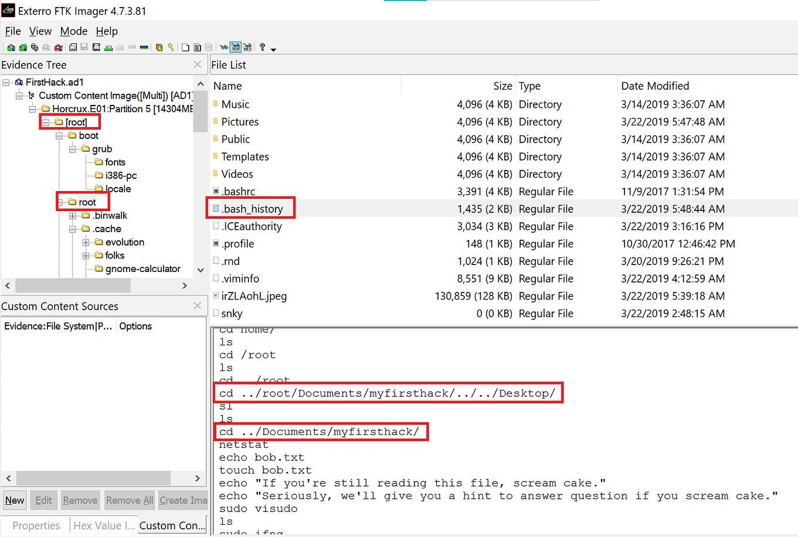

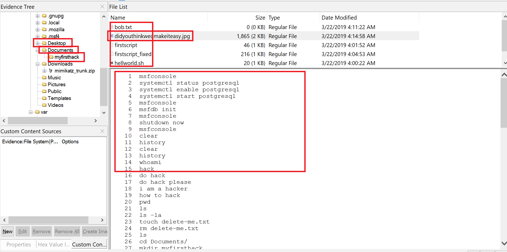

```
/root/Documents/myfirsthack/
```

# **Thanks For Reading**

#CyberDefenders #CyberSecurity #BlueYard #BlueTeam #InfoSec #SOC #SOCAnalyst #DFIR #CCD #CyberDefender
