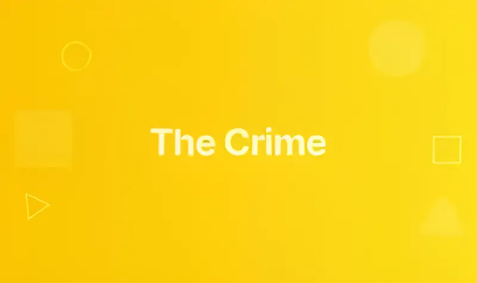
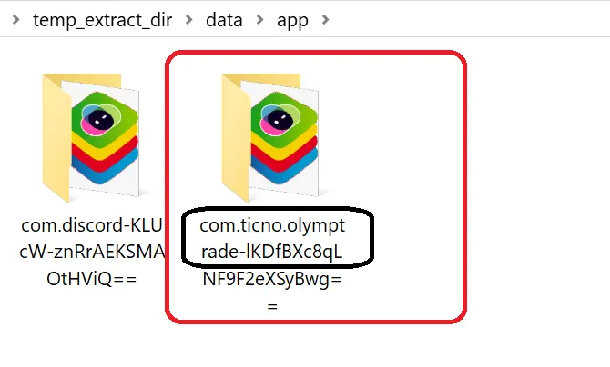
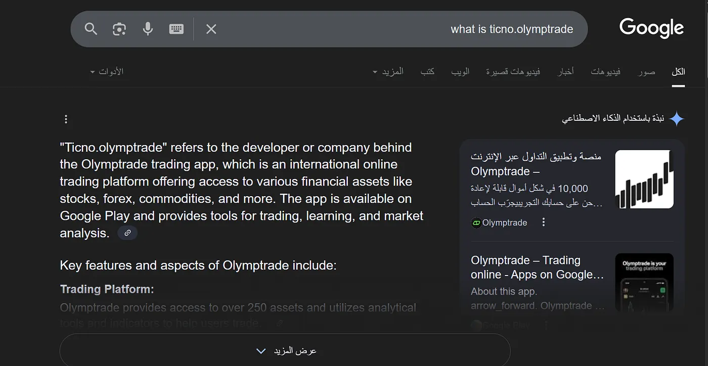
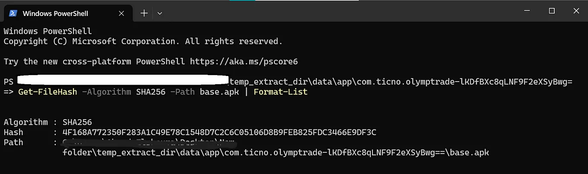
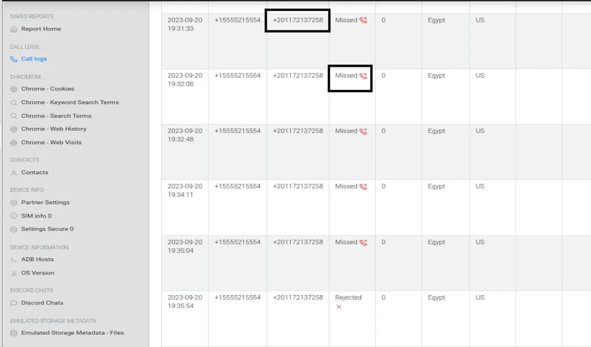
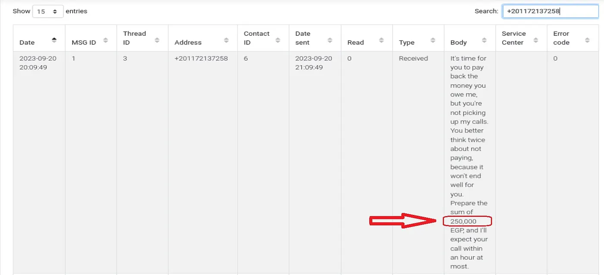
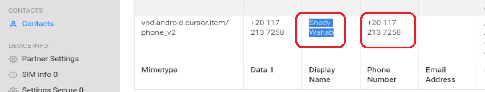
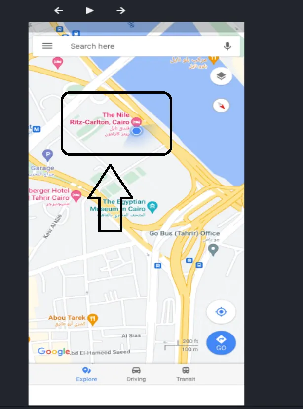
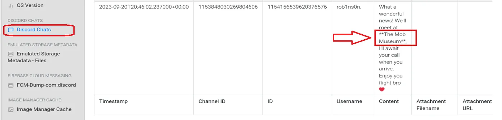
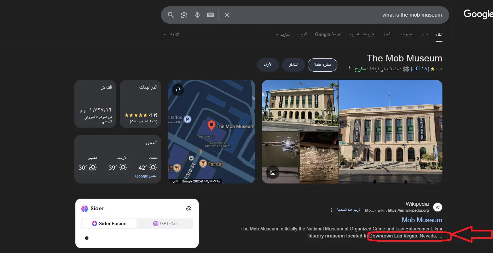

### hi everyone, anther write-up for lab about my fav platform CyberDefender

[**Blue team CTF Challenges | The Crime — CyberDefenders**](https://cyberdefenders.org/blueteam-ctf-challenges/the-crime/)

### **Category :** [Endpoint Forensics](https://cyberdefenders.org/blueteam-ctf-challenges/?categories=endpoint-forensics)



### **Scenario :**
We’re currently in the midst of a murder investigation, and we’ve obtained the victim’s phone as a key piece of evidence. After conducting interviews with witnesses and those in the victim’s inner circle, your objective is to meticulously analyze the information we’ve gathered and diligently trace the evidence to piece together the sequence of events leading up to the incident.

---

# **Q1: Based on the accounts of the witnesses and individuals close to the victim, it has become clear that the victim was interested in trading. This has led him to invest all of his money and acquire debt. Can you identify the SHA256 of the trading application the victim primarily used on his phone?**

### by Mobility between folders in app folder I noticed this file :



### look this name “ticno.olymptrade” by search about this name :



### now i need SHA256 :



```jsx
4F168A772350F283A1C49E78C1548D7C2C6C05106D8B9FEB825FDC3466E9DF3C
```

---

# **Q2: According to the testimony of the victim’s best friend, he said, “While we were together, my friend got several calls he avoided. He said he owed the caller a lot of money but couldn't repay now". How much does the victim owe this person?**

Now we are using the famous ALEAAP tool:

GitHub - abrignoni/ALEAPP: Android Logs Events And Protobuf Parser
Android Logs Events And Protobuf Parser
[github.com](http://github.com/)

### After the ALEAAP tool produced the report for the file, we can now accurately analyze who obtained the victim’s phone.

### i go to CALL LOGs to see last calls, i noticed many missed calls:



### Now we have the caller’s number “ +201172137258 ” This is the number of the person from whom the victim borrowed money.

### i go to SMS messages section and search by number “ +201172137258 ” :



```jsx
250000
```

---

# **Q3: What is the name of the person to whom the victim owes money?**

### i go to contacts section and search about “ +201172137258 ”:



```jsx
Shady Wahab
```

---

# **Q4: Based on the statement from the victim’s family, they said that on September 20, 2023, he departed from his residence without informing anyone of his destination. Where was the victim located at that moment?**

### now i go to Report Output folder >> _HTML >> Recent Activity >> 6.jpg :



```jsx
The Nile Ritz-Carlton
```

---

# **Q5: The detective continued his investigation by questioning the hotel lobby. She informed him that the victim had reserved the room for 10 days and had a flight scheduled thereafter. The investigator believes that the victim may have stored his ticket information on his phone. Look for where the victim intended to travel.**

### go to Discord Chats section , i found this message :



### by search about the mob museum :



```jsx
las vegas
```

# **Q6: After examining the victim’s Discord conversations, we discovered he had arranged to meet a friend at a specific location. Can you determine where this meeting was supposed to occur?**

```jsx
the mob museum
```

### Thanks For Reading
#CyberDefenders #CyberSecurity #BlueYard #BlueTeam #InfoSec #SOC #SOCAnalyst #DFIR #CCD #CyberDefender
