Welcome to this walkthrough of the Snort Challenge: Live Attacks Room on TryHackMe. In this Snort challenge room we get to practice our newly aquired Snort skills to cement our knowledge further. This room follows upon the theory learned in the Snort Room, which I have covered in this article:

lab link:

[Snort Challenge - Live Attacks](https://tryhackme.com/r/room/snortchallenges2)

we have two challanges :

1-  **Scenario 1 | Brute-Force**

**2-  Scenario 2 | Reverse-Shell**

---

**Scenario 1 | Brute-Force**

***[+] THE NARRATOR***

*J&Y Enterprise is one of the top coffee retails in the world. They are known as tech-coffee shops and serve millions of coffee lover tech geeks and IT specialists every day.*

*They are famous for specific coffee recipes for the IT community and unique names for these products. Their top five recipe names are;*

***WannaWhite**, **ZeroSleep**, **MacDown**, **BerryKeep** and **CryptoY**.*

*J&Y’s latest recipe, “**Shot4J**“, attracted great attention at the global coffee festival. J&Y officials promised that the product will hit the stores in the coming months.*

*The super-secret of this recipe is hidden in a digital safe. Attackers are after this recipe, and J&Y enterprises are having difficulties protecting their digital assets.*

*Last week, they received multiple attacks and decided to work with you to help them improve their security level and protect their recipe secrets.*

*This is your assistant **J.A.V.A. (Just Another Virtual Assistant).** She is an AI-driven virtual assistant and will help you notice possible anomalies. Hey, wait, something is happening…*

***[+] J.A.V.A.***

*Welcome, sir. I am sorry for the interruption. It is an emergency. Somebody is knocking on the door!*

***[+] YOU***

*Knocking on the door? What do you mean by “knocking on the door”?*

***[+] J.A.V.A.***

*We have a brute-force attack, sir.*

***[+] THE NARRATOR***

*This is not a comic book! Would you mind going and checking what’s going on! Please…*

***[+] J.A.V.A**.*

***Sir, you need to observe the traffic with Snort and identify the anomaly first. Then you can create a rule to stop the brute-force attack. GOOD LUCK!***

# **Questions**

*First of all, start Snort in sniffer mode and try to figure out the attack source, service and port.*

*Then, write an IPS rule and run Snort in IPS mode to stop the brute-force attack. Once you stop the attack properly, you will have the flag on the desktop!*

*Here are a few points to remember:*

- *Create the rule and test it with “-A console” mode.*
- *Use **“-A full”** mode and the **default log path** to stop the attack.*
- *Write the correct rule and run the Snort in IPS “-A full” mode.*
- *Block the traffic at least for a minute and then the flag file will appear on your desktop.*

*Stop the attack and get the flag (which will appear on your Desktop)*

---

This section describes the **initial step** in identifying and stopping a brute-force attack using **Snort**, a powerful network intrusion detection tool.

i starts Snort in **sniffer mode** to monitor live network traffic using this command:

```bash
sudo snort -devX
```

Here’s what each flag does briefly:

- **d** → shows the packet payload (actual data sent).
- **e** → shows link-layer headers (protocol info like TCP, UDP, ICMP).
- **v** → enables verbose mode for detailed output.
- **X** → shows the full packet in both text and HEX format.

Running Snort for **10–15 seconds** captures enough data to observe what’s happening on the network.

Since the scenario involves a **brute-force attack**, the focus is on detecting **many repeated connection attempts** to the same IP or service — a clear brute-force pattern.

Finally, the author collected **1934 packets in 12 seconds**, which confirms **high traffic volume** and potential malicious activity.

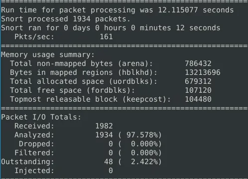

I started scrolling through the packets, and noticed a lot of packets running from port 22 on 10.10.140.29 to port 46634 on 10.10.245.36.

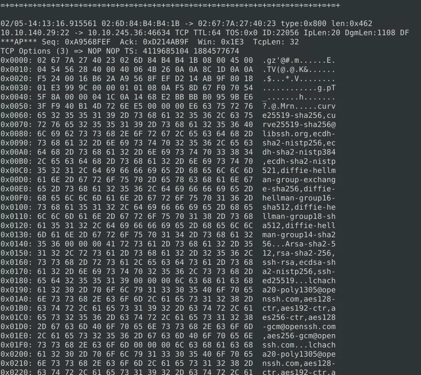

**network traffic** being captured is related to **SSH (Secure Shell)**, which runs on **port 22** — a common port used for remote login to servers.

The packets belong to the **initial handshake phase** of SSH, called the **key exchange**. During this phase, the **client and server share information** about which **encryption and authentication algorithms** they support (for example, `ecdsa-sha2-nistp256` and `ssh-ed25519`).

There are more examples of this:

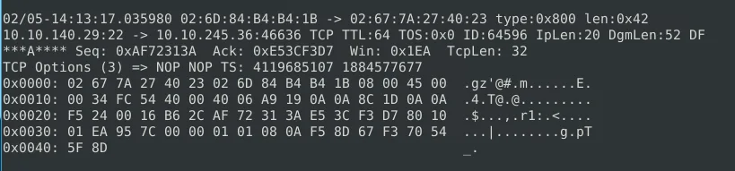

But traffic should be moving towards port 22, and the last two packets are merely responses from the server. Scroll a bit up and you will see traffic going the other way, likely the attacker trying to connect to the SSH server:

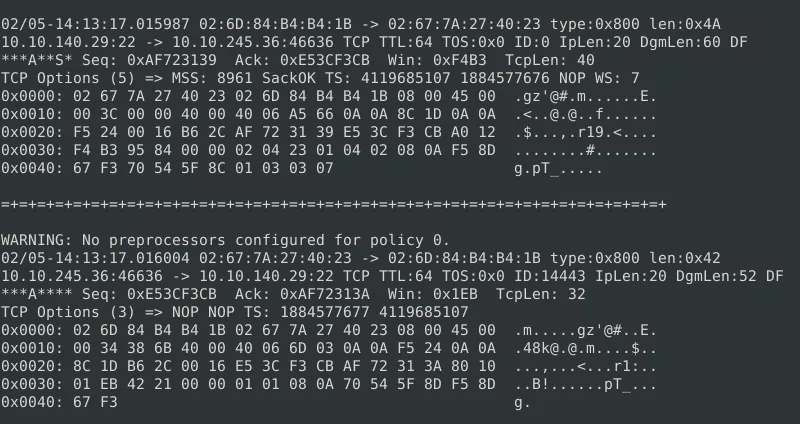

 **analyzing TCP flags** seen in the captured network packets to understand what kind of communication is happening — in this case, it’s related to **SSH connections** and possibly a **brute-force attack**.

---

### 🔹 TCP Flags Overview

TCP (Transmission Control Protocol) uses several **flags** to control the connection between two systems.

Here are the important ones mentioned:

- **SYN (Synchronize)** → Used to initiate a connection.
- **ACK (Acknowledge)** → Used to confirm that data or a request has been received.

So when you see:

- `AS` → means **ACK + SYN**, which is usually part of **starting** a connection.
- `A` → means **ACK**, which confirms that the previous message was received.

---

### 🔹 The TCP Three-Way Handshake

Every TCP connection starts with a **three-step handshake** between a client and a server:

1. **SYN (Client → Server)**
    
    The client sends a SYN packet to request a new connection.
    
2. **SYN/ACK (Server → Client)**
    
    The server responds with a SYN/ACK packet, meaning:
    
    - **SYN:** "I agree to start a connection."
    - **ACK:** "I received your SYN request."
3. **ACK (Client → Server)**
    
    The client replies with a final ACK packet to confirm the connection is established.
    
    ✅ At this point, both sides are ready to communicate.
    

---

### 🔹 What’s Happening Here

The text says we’re observing **the last two parts** of this handshake:

- **SYN/ACK** → from the server back to the client.
- **ACK** → from the client to the server.

This shows **successful TCP handshakes**, meaning multiple clients are trying to establish SSH connections (port 22).

---

### 🔹 Suspicious Behavior

The analyst also notices that there are **multiple different IP addresses** connecting to the SSH service.

That’s a big red flag  — because in normal cases, you’d expect only one or a few IPs connecting.

But here, many IPs are making handshake attempts, which suggests:

- The use of **botnets**, **VPNs**, or **proxies**.
- The attacker is trying to **brute-force SSH login credentials** from many different sources to avoid detection or blocking.

---

### 🔹 Next Step: Capturing Data

Since suspicious SSH activity is confirmed, the next logical step is to **log the traffic into a `.pcap` file**.

This allows for deeper analysis later using tools like **Wireshark**, where the analyst can inspect:

- Source IPs,
- Connection frequency,
- Payload patterns,
- and possible brute-force indicators.

---

✅ **In summary:**

The captured packets show multiple TCP handshakes (SYN/ACK and ACK) on port 22, indicating repeated SSH connection attempts from different IPs — a clear sign of a possible **SSH brute-force attack**.

To investigate further, the analyst decides to **save the network traffic** into a `.pcap` file for offline examination.

---

We can either log in packet logger mode with ASCII mode:

```
sudo snort -dev -K ASCII
```

A directory structure will get formed, and here we can see that there exists a folder named 10.10.245.36 (the attacker machine). In it you will find many log files for all the differents ports it used to attack our SSH service

Alternatively you can log regularly by running:

```
sudo snort -dev -l .
```

This creates a snort.log.<number> file which you can read like this:

```
sudo snort -r snort.log.<number>
```

This time, I captured 4516 packets.

# **A primer on BPF (Berkeley Packet Filter)**

We can filter the packages we read in Snort by using a language called BPF.

One of the possibilities is to filter on port and tcp by running:

```
sudo snort -r snort.log.1738782688 'tcp and port 22'
```

This returns 619 packets, which is quite a relatively large chunk of the total traffic.

Alternatively you can use:

```
sudo snort -r snort.log.1738782688 'host 10.10.245.36'
```

This shows that a total of 619 packets are involved with the attacker machine, and we can probably conclude that all of these are connecting to the SSH service:

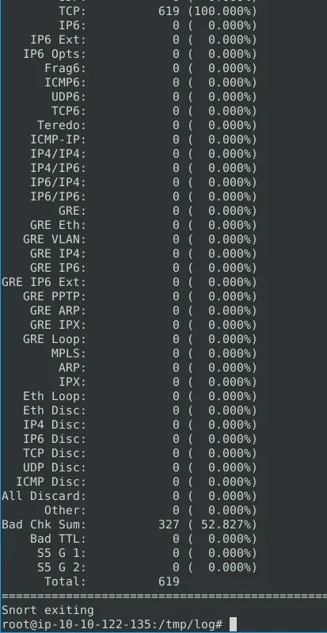

# **Stopping the attack**

We did a little bit of extra work to proof that 10.10.245.36 is the machine attacking us with a brute-force attack. Now all we need to do is create a rule, and start up Snort in IPS mode. What to put in the rule? I guess we could block the SSH, but that could cause problems. The easiest method is by blocking the malicious IP address.

The local.rules file is located here:

```
/etc/snort/rules/local.rules
```

You can edit it like so:

```
sudo gedit /etc/snort/rules/local.rules
```

I propose we add the following rule:

```
alert tcp 10.10.245.36 any -> any 22 (msg:"Traffic originating from suspicious host"; sid:100001; rev:1;)
```

We can now test the rule by running:

```
sudo snort -c /etc/snort/rules/local.rules -A console
```

And sure enough, you should see alert messages popping up:

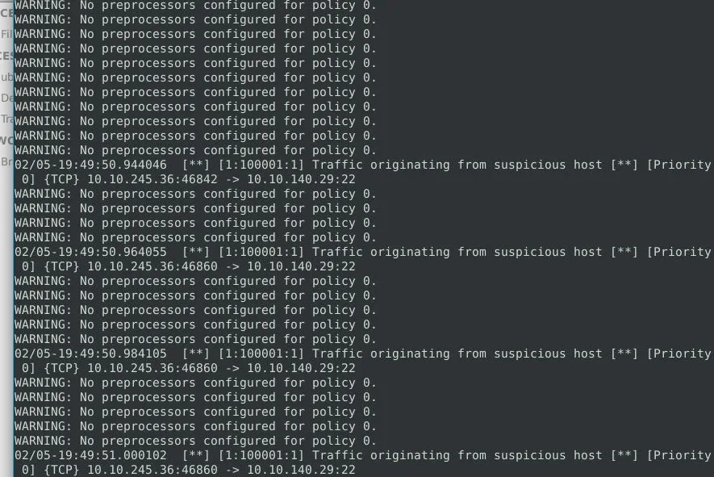

Now we can run snort with the -A full option, which adds the printing of full alert information, as suggested in the task.

```
sudo snort -c /etc/snort/rules/local.rules -A full
```

Keep it running for a minute.

A flag should be created on your Desktop:

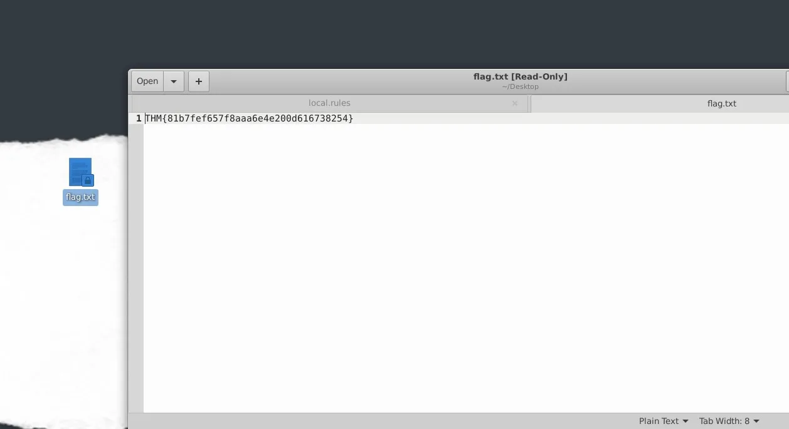

> Answer:THM{81b7fef657f8aaa6e4e200d616738254}
> 

# **What is the name of the service under attack?**

We discussed this above. The service is SSH.

> Answer: SSH
> 

# **What is the used protocol/port in the attack?**

The SSH service is running on TCP port 22.

> Answer: TCP/22
> 

---

---

---

## **Task 3: Scenario 2 | Reverse-Shell**

*[+] THE NARRATOR*

*Good Job! Glad to have you in the team!*

***[+] J.A.V.A.***

*Congratulations sir. It is inspiring watching you work.*

***[+] You***

*Thanks team. J.A.V.A. can you do a quick scan for me? We haven’t investigated the outbound traffic yet.*

***[+] J.A.V.A.***

*Yes, sir. Outbound traffic investigation has begun.*

***[+] THE NARRATOR***

*The outbound traffic? Why?*

***[+] YOU***

*We have stopped some inbound access attempts, so we didn’t let the bad guys get in. How about the bad guys who are already inside? Also, no need to mention the insider risks, huh? The dwell time is still around 1-3 months, and I am quite new here, so it is worth checking the outgoing traffic as well.*

***[+] J.A.V.A.***

*Sir, persistent outbound traffic is detected. Possibly a reverse shell…*

***[+] YOU***

*You got it!*

***[+] J.A.V.A.***

*Sir, you need to observe the traffic with Snort and identify the anomaly first. Then you can create a rule to stop the reverse shell. GOOD LUCK!*

# **Questions**

*First of all, start Snort in sniffer mode and try to figure out the attack source, service and port.*

*Then, write an IPS rule and run Snort in IPS mode to stop the brute-force attack. Once you stop the attack properly, you will have the flag on the desktop!*

*Here are a few points to remember:*

- *Create the rule and test it with “-A console” mode.*
- *Use “-A full” mode and the default log path to stop the attack.*
- *Write the correct rule and run the Snort in IPS “-A full” mode.*
- *Block the traffic at least for a minute and then the flag file will appear on your desktop.*

# **Stop the attack and get the flag (which will appear on your Desktop)**

Well, we know the drill. The process will be very much like the previous task. We need to investigate the current traffic, and block is afterwards,

Make sure you started up the machine attached to this task.

Let’s again run the following command:

```
sudo snort -devX
```

This gives us as much as possible data to look at, and display the details in HEX format as well.

I will keep it running again for 10-15 seconds so we have enough data to look at. This time we should be looking for a reverse shell so we should be looking out for traffic that originates from the hsot and towards the attacker.

This time I ended up analyzing 3987 packets within around 16 seconds.

Now proceed as before. Let’s simply scroll around through the traffic to get a feeling for the data and to see if we see something suspicious.

It didn’t took long for me to find something VERY suspicious:

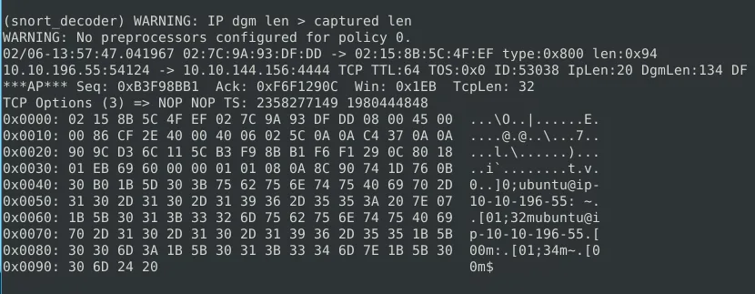

There are actually 3 interesting findings here:

1. The payload includes shell prompt information, likely from an interactive shell session.
2. What is even more suspicious is the fact that it being sent to port 4444. If you have some experience with penetration testing, you will know that port 4444 is often used to setup reverse shells. It is especially commonly used by Metasploit.
3. The combination of ACK + PUSH (**AP**) flags indicates that this is active data transfer rather than just a handshake.

There is more suspicious activity from the same host and with the same destination:

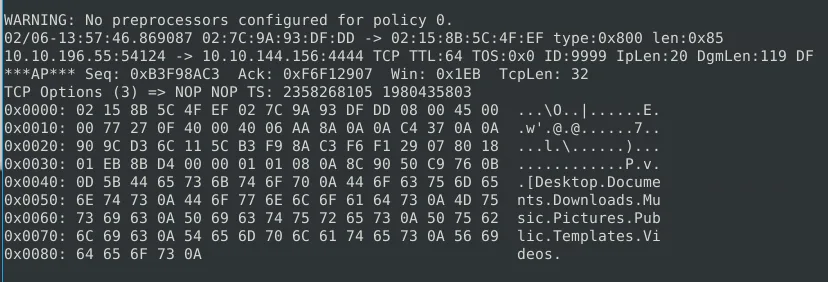

Again, more evidence. The file paths in the payload may indicate that the attacker is gathering information or attempting to exfiltrate files.

I feel like we have enough evidence. Let’s stop the attack ASAP.

# **Stopping the attack**

Once again, we have to write a rule and start up Snort in IPS mode. I think we should block the source IP address we found to make sure the attacker will get stopped from that IP. In addition, I think we could block port 4444.

The local.rules file is located here:

`/etc/snort/rules/local.rules`

You can edit it like so:

`sudo gedit /etc/snort/rules/local.rules`

I propose we add the following rule to stop traffic from the host:

```
alert tcp 10.10.196.55 any -> any any (msg:"Traffic from malicious host"; sid:100001; rev:1;)
```

And all traffic towards port 4444 in case the attacker uses different IPs.

```
alert tcp any any -> any any (msg:"Potential Reverse Shell on Port 4444"; sid:100002; rev:1;)
```

They should look like this:

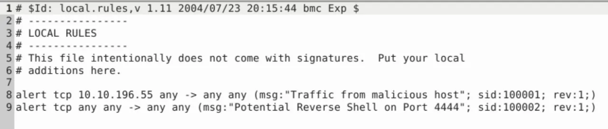

We can now test the rules by running:

```
sudo snort -c /etc/snort/rules/local.rules -A console
```

And yet again, alerts are popping up:

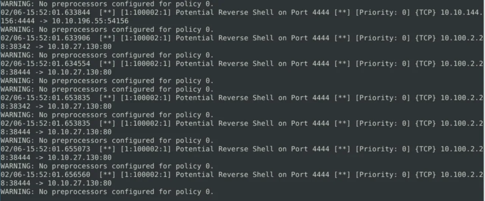

Now we can run snort with the -A full option as suggested in the task.

```
sudo snort -c /etc/snort/rules/local.rules -A full
```

Keep it running for a minute.

A flag should again be created on your Desktop:

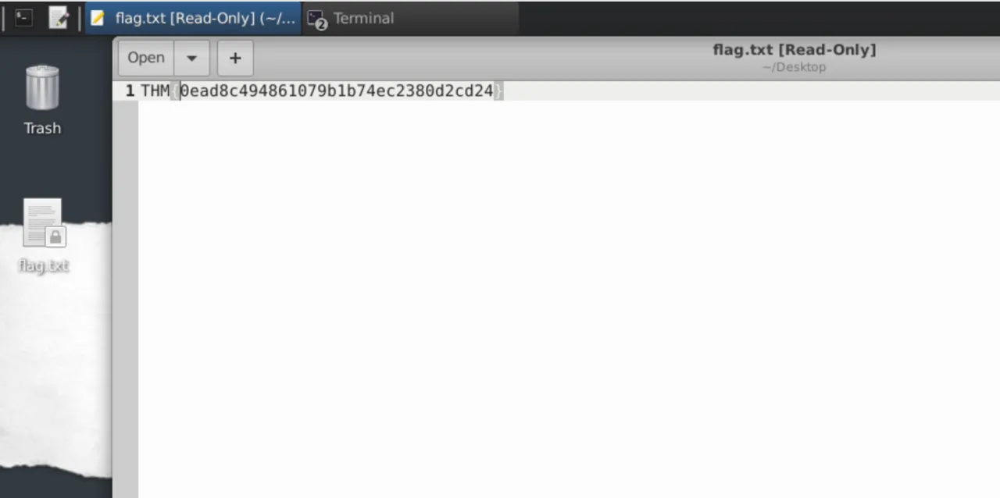

> Answer: THM{0ead8c494861079b1b74ec2380d2cd24}
> 

# **What is the used protocol/port in the attack?**

We saw in the packets that all traffic used to TCP protocol. In addition, we noted connections aiming at port 4444.

> Answer: tcp/4444
> 

# **Which tool is highly associated with this specific port number?**

The tool commonly associated with port 4444 is Metasploit. A ton of exploits running through Metasploit use port 4444 as default. As you know, people are lazy so many often run this default port 🙂

> Answer: Metasploit
> 

---

# **Congratulations on completing Snort Challenge – Live Attacks!!!**
