**(SOC Level 1)**

Room URL: [https://tryhackme.com/r/room/fridayovertime](https://tryhackme.com/r/room/fridayovertime)

type: threat intelligence

This room is part of the SOC Level 1 Path.

I am making these walkthroughs to keep myself motivated to learn cyber security, and ensure that I remember the knowledge gained by these challenges on HTB and THM. Join me on learning cyber security. I will try and explain concepts as I go, to differentiate myself from other walkthroughs.

Now, let’s move on!

# **Task 1: Challenge Scenario**

First an introduction to the scenario from TryHackMe:

***Please note:** The artefacts used in this scenario were retrieved from a real-world cyber-attack. Hence, it is advised that interaction with the artefacts be done only inside the attached VM, as it is an isolated environment.*

*Hello Busy Weekend. . .*

*It’s a Friday evening at PandaProbe Intelligence when a notification appears on your CTI platform. While most are already looking forward to the weekend, you realise you must pull overtime because SwiftSpend Finance has opened a new ticket, raising concerns about potential malware threats. The finance company, known for its meticulous security measures, stumbled upon something suspicious and wanted immediate expert analysis.*

*As the only remaining CTI Analyst on shift at PandaProbe Intelligence, you quickly took charge of the situation, realising the gravity of a potential breach at a financial institution. The ticket contained multiple file attachments, presumed to be malware samples.*

*With a deep breath, a focused mind, and the longing desire to go home, you began the process of:*

1. *Downloading the malware samples provided in the ticket, ensuring they were contained in a secure environment.*
2. *Running the samples through preliminary automated malware analysis tools to get a quick overview.*
3. *Deep diving into a manual analysis, understanding the malware’s behaviour, and identifying its communication patterns.*
4. *Correlating findings with global threat intelligence databases to identify known signatures or behaviours.*
5. *Compiling a comprehensive report with mitigation and recovery steps, ensuring SwiftSpend Finance could swiftly address potential threats.*

***Note:** While the web browser (i.e., Chromium) will immediately start after boot up, it may show a tab that has a “502 Bad Gateway” error message displayed. This is because the DocIntel platform takes about 5 more minutes to finish starting up **after** the VM has completely booted up. After 5 minutes, you can **refresh** the page in order to view the login page. We appreciate your patience. The ticket details can be found by logging in to the DocIntel platform. **OSINT, a web browser, and a text editor outside the VM will also help.***

---

---

# **Questions**

# **1. Who shared the malware samples?**

Alright, let’s go! Start up the machine attached to the room and wait around 5 minutes for everything to boot up. Login with the initials written in the room, and you should arrive in the DocIntel system.

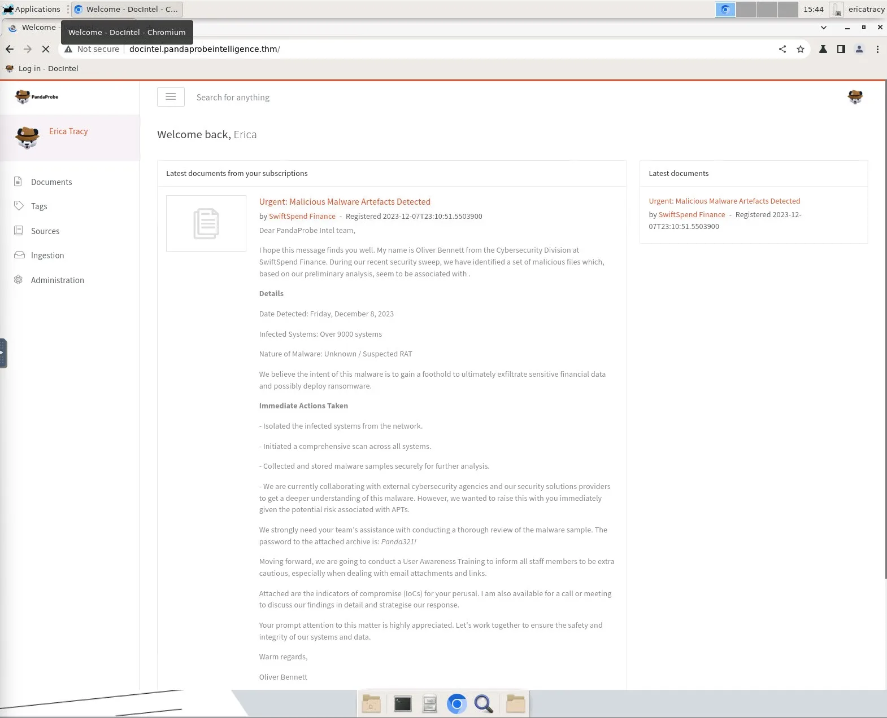

We are met by a document with the name *Urgent: Malicious Malware Artefacts Detected*. Click on the title to get all the details.

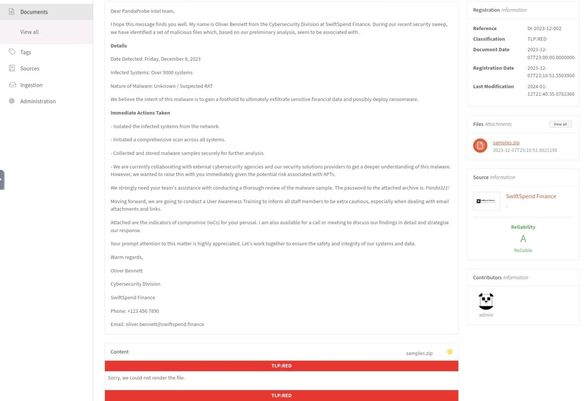

Of interest is the zip file with a malware sample, and the name of the person who has shared the file. The answer is simply the sender of the email: Oliver Bennett.

> **Answer**: Oliver Bennett
> 

---

---

# **2. What is the SHA1 hash of the file “pRsm.dll” inside samples.zip?**

Download the file by clicking on the attachment, making sure to use the AttackBox as the artefacts used in this scenario were retrieved from a real-world cyber-attack.

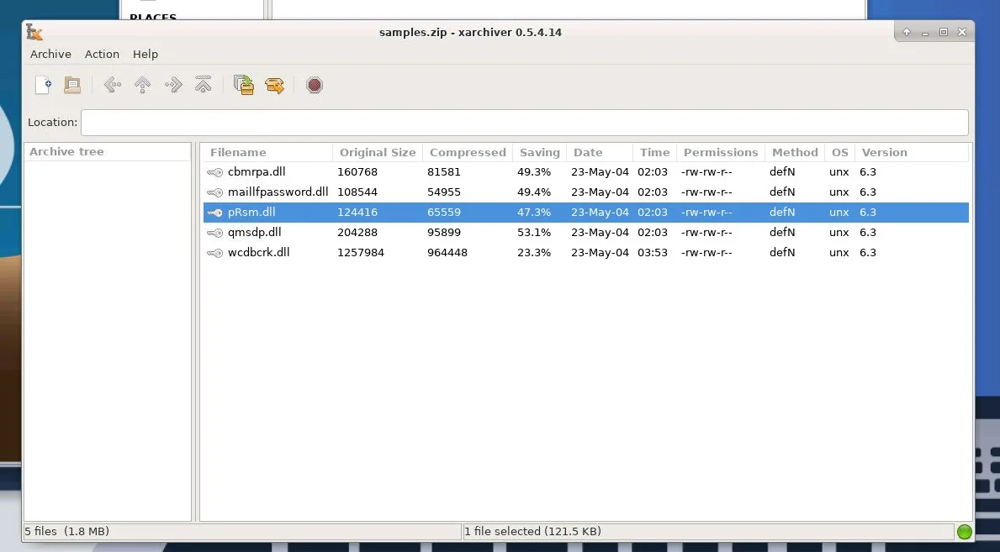

In the archive we see the file pRsm.dll referred to in the question. Unzip the contents to a folder (in my case /tmp), noting that the password for the archive is mentioned in the message from Oliver: Panda321!.

To get the SHA1 hash file we can run the following command:

```
sha1sum /tmp/pRsm.dll 
```


The sha1 hash is 9d1ecbbe8637fed0d89fca1af35ea821277ad2e8.

> Answer: 9d1ecbbe8637fed0d89fca1af35ea821277ad2e8
> 

---

---

# **3. Which malware framework utilizes these DLLs as add-on modules?**

Now, there are different platforms to find info on our malware samples. We could use VirusTotal, which accepts SHA1 hashes as search input:

[https://www.virustotal.com/gui/file/2c0cfe2f4f1e7539b4700e1205411ec084cbc574f9e4710ecd4733fbf0f8a7dc/detection](https://www.virustotal.com/gui/file/2c0cfe2f4f1e7539b4700e1205411ec084cbc574f9e4710ecd4733fbf0f8a7dc/detection)

We could also have googled around and found the same info.

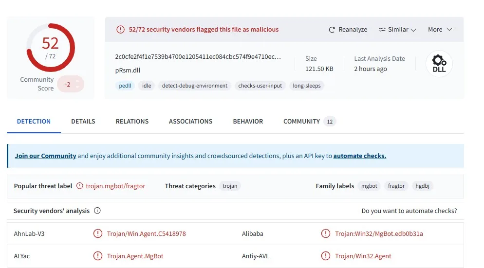

Here we can see a lot of data, including the malware framework which is mentioned different places. It is MgBot.

You can read more information here:

[https://www.welivesecurity.com/2023/04/26/evasive-panda-apt-group-malware-updates-popular-chinese-software](https://www.welivesecurity.com/2023/04/26/evasive-panda-apt-group-malware-updates-popular-chinese-software)

*MgBot is the primary Windows backdoor used by Evasive Panda, which according to our findings has existed since at least 2012 and, as mentioned in this blog post, was publicly [documented at VirusBulletin in 2014](https://www.virusbulletin.com/virusbulletin/2014/02/needle-haystack). It was developed in C++ with an object-oriented design, and has the capabilities to communicate via TCP and UDP, and extend its functionality via plugin modules.*

*MgBot’s installer and backdoor, and their functionality, have not changed significantly since it was first documented. Its chain of execution is the same as described in this [report](https://www.malwarebytes.com/blog/news/2020/07/chinese-apt-group-targets-india-and-hong-kong-using-new-variant-of-mgbot-malware) by Malwarebytes from 2020.*

> Answer: MgBot
> 

---

---

# **4. Which MITRE ATT&CK Technique is linked to using pRsm.dll in this malware framework?**

We can find the answer to this question on the previously mentioned page (https://www.welivesecurity.com/2023/04/26/evasive-panda-apt-group-malware-updates-popular-chinese-software/).

If we scroll down we find a list of MITRE ATT&CK techniques.

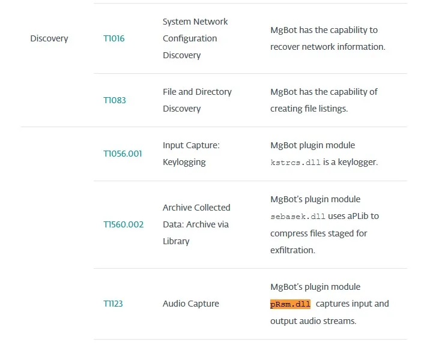

One of the rows mentions pRsm.dll, and related the plugin module to input and output audio streams capture.

> Answer: T1123
> 

---

---

# **5. What is the CyberChef defanged URL of the malicious download location first seen on 2020-11-02?**

Again one the same page, we can find the following information:

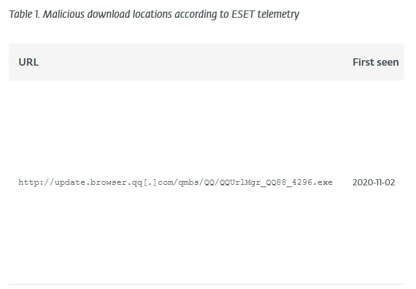

If we copy this URL in CyberChef (found at [https://gchq.github.io/CyberChef/](https://gchq.github.io/CyberChef/)) and defang it (URL defanging is a process that modifies potentially harmful links, making them non-functional and safe to share), we will get the following defanged URL:

hxxp[://]update[.]browser[.]qq[.]com/qmbs/QQ/QQUrlMgr_QQ88_4296.exe

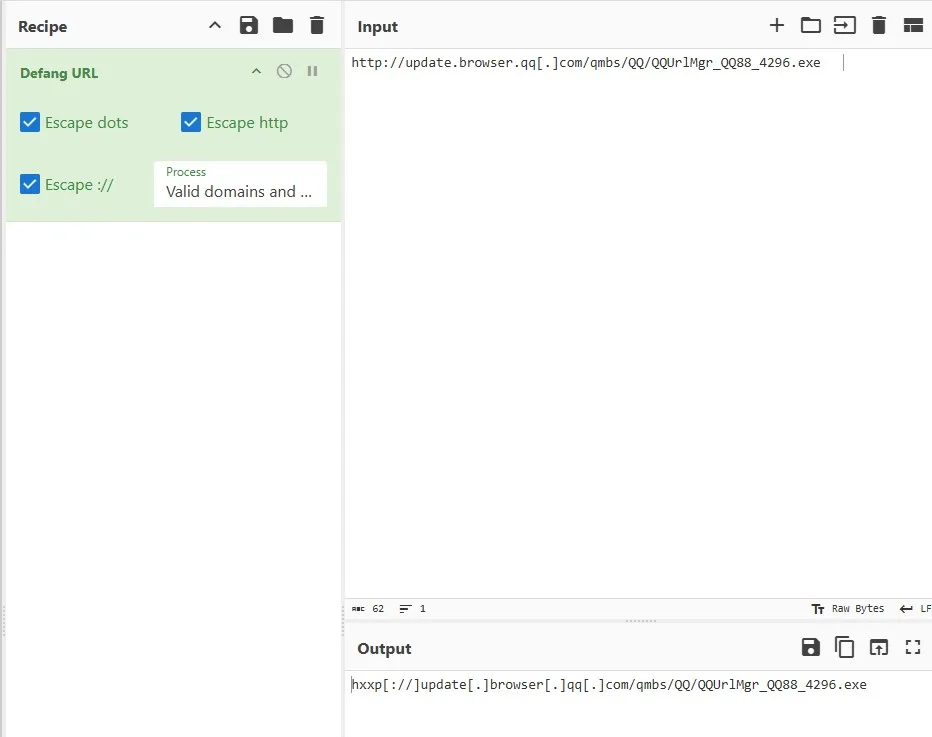

> Answer: hxxp[://]update[.]browser[.]qq[.]com/qmbs/QQ/QQUrlMgr_QQ88_4296.exe
> 

---

---

# **6. What is the CyberChef defanged IP address of the C&C server first detected on 2020-09-14 using these modules?**

We are lucky again with this page. We can also find the info we need, just above the ATT&CK section:

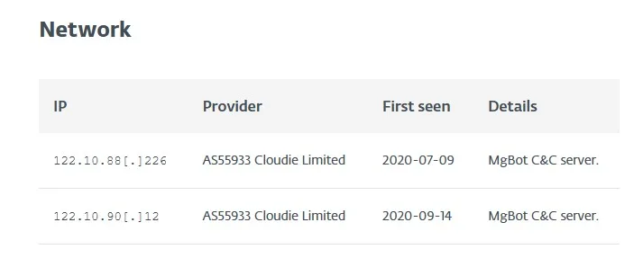

It is the IP on the first row. Following the same process with Cyberchef we get the defanged IP. Make sure to remove the [.] when using the IP as input in the Cyberchef recipe.

> Answer: 122[.]10[.]90[.]12
> 

---

---

# **7. What is the SHA1 hash of the spyagent family spyware hosted on the same IP targeting Android devices on November 16, 2022?**

We can use VirusTotal for this to get the result. Search for the previously found IP address on VirusTotal and you will find this page:

[https://www.virustotal.com/gui/ip-address/122.10.90.12](https://www.virustotal.com/gui/ip-address/122.10.90.12)

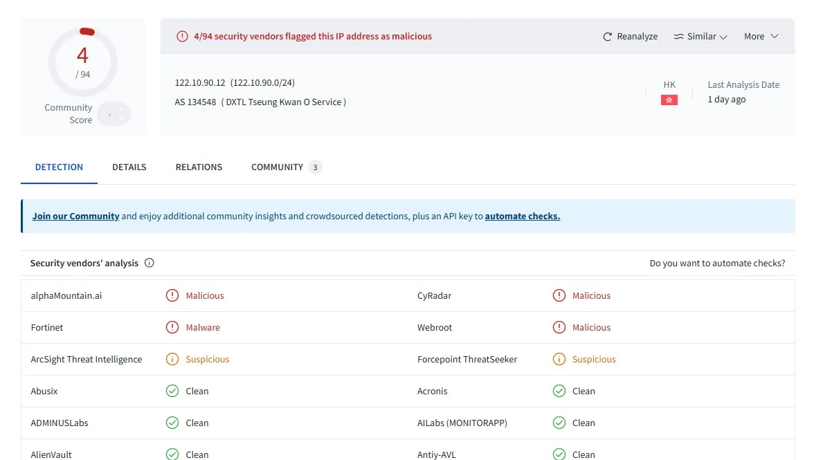

Now go into the relations tab. Think of this as elements that have a relationship to the URL entity.

Remember the question mentioned  Android devices on November 16, 2022? There is an entry under *Communicating Files* which mentioned the correct date and Android devices. This file must be the one we are looking for.

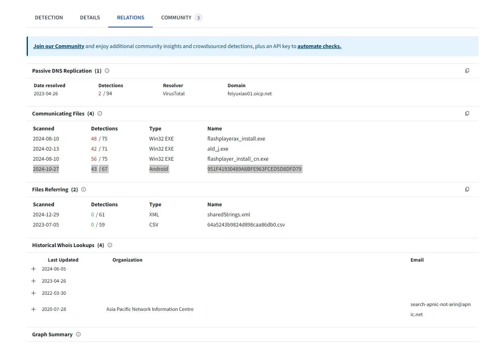

Click on the name and you will get to the following page:

[https://www.virustotal.com/gui/file/bbef5975a0483220cfec379c44a487ed4146e0af9205f00dbc0eb53de8a63533](https://www.virustotal.com/gui/file/bbef5975a0483220cfec379c44a487ed4146e0af9205f00dbc0eb53de8a63533)

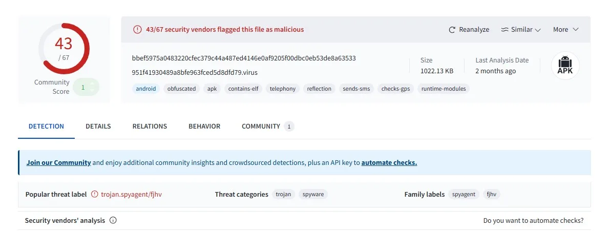

This is the all info on the Spyware file that has a relationship to the earlier found IP.

Now, go into the details tab, and here you can see the hashes, including the SHA1 the question expects:

1c1fe906e822012f6235fcc53f601d006d15d7be.

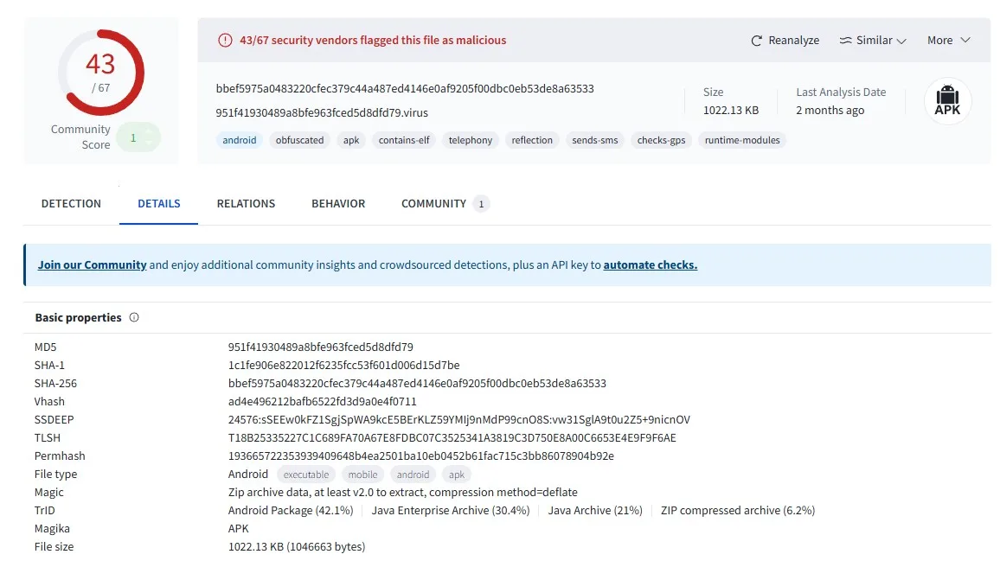

> **Answer***:* 1c1fe906e822012f6235fcc53f601d006d15d7be
> 

Congratulations on completing Friday Overtime!!!

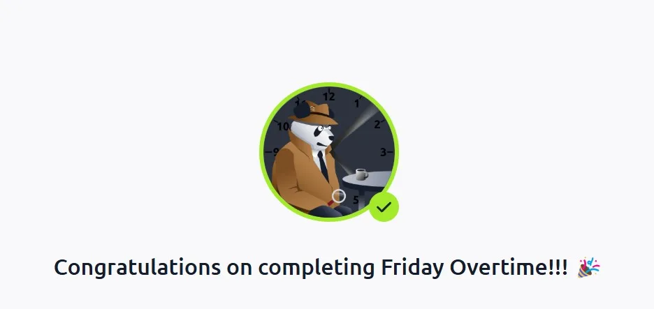
